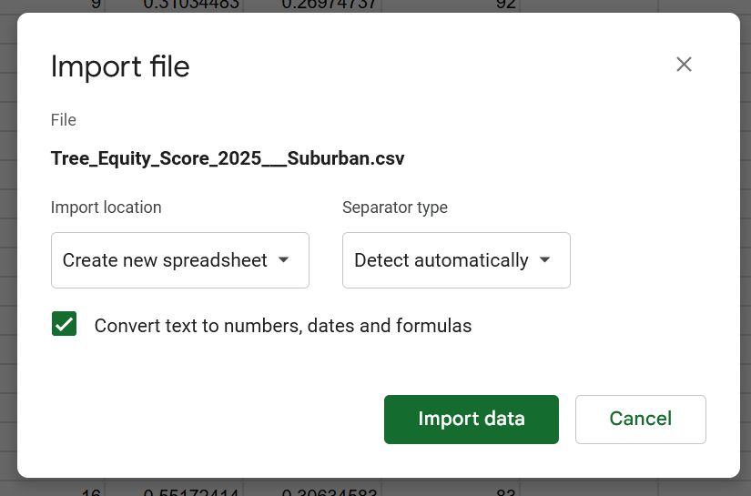

**2026-11-05**<br>
**MPAD 2003 - Introductory Data Storytelling**<br>
**Beracah Okere**<br>
**Presented to Jean-Sébastien Marier**<br>

# Deliverable 2: Exploratory Data Analysis (EDA)

<!---Use one hashtag symbol (`#`) to create a level 1 heading like this one.--->

## Foreword

<!---For this assignment, you must clean and analyze the dataset from Deliverable 1, create exploratory charts/visualizations, and identify a potential story. Your assignment must clearly detail your process. You are expected to write about 1,000-1,200 words, and to include several screen captures showing the different steps you went through. Your assignment must be written with the Markdown format and submitted on GitHub.

I have been assigning different versions of this project to my digital journalism and data storytelling students for a few years now. Its structure was inspired by the main sections/chapters of [*The Data Journalism Handbook*](https://datajournalism.com/read/handbook/one/). This version was further inspired by the [Key Capabilities in Data Science](https://extendedlearning.ubc.ca/programs/key-capabilities-data-science) program offered by the University of British Columbia (UBC).

**Here are some useful resources for this assignment:**

* [GitHub's *Basic writing and formatting syntax* page](https://docs.github.com/en/get-started/writing-on-github/getting-started-with-writing-and-formatting-on-github/basic-writing-and-formatting-syntax)
* [The template repository for this assignment in case you delete something by mistake](https://github.com/jsmarier/jou4100_jou4500_mpad2003_project2_template)

Did you notice how to create a hyperlink? In Markdown, we put the clickable text between square brackets and the actual URL between parentheses.

And to create an unordered list, we simply put a star (`*`) before each item.--->

## 1. Getting Data
I will be analyzing a group of datasets: the Tree Equity Score 2025 datasets for the Suburban, Downtown Core, Inner Urban & Outer Urban transects in Ottawa which discuss the Tree Equity Scores for the tracts within these transects as well as other additional information like the tree canopy coverage goal for the transect, how much an individual tract contributes to the goal, and which tracts are marked as priority areas.

To acquire my data, I went onto the Open Ottawa Data portal where I grabbed the [Tree Equity Score 2025 – Suburban](https://open.ottawa.ca/datasets/ottawa::tree-equity-score-2025-suburban/about), [Tree Equity Score 2025 - Inner Urban](https://open.ottawa.ca/datasets/ottawa::tree-equity-score-2025-inner-urban/about), [Tree Equity Score 2025 - Outer Urban](https://open.ottawa.ca/datasets/ottawa::tree-equity-score-2025-outer-urban/about) and [Tree Equity Score 2025 - Downtown Core](https://open.ottawa.ca/datasets/ottawa::tree-equity-score-2025-downtown-core/about) CSV files and imported them into a Google Sheets spreadsheet - with each dataset as separate sheets.

[Link to Google Sheets Spreadsheet](https://docs.google.com/spreadsheets/d/1d3Lvmx_JqoSBCxjXgUR8HhP2DmRbiaoiUP7RjvqKjkI/edit?usp=sharing)


*Figure 1: Example of me importing a dataset into Google Sheets*

The datasets I had imported were mostly clean, being very  easy to understand all and I was unable to find any spelling mistakes, whitespaces or other issues that could cause concern. The sets also have a combined total of 217 rows and 22 columns.


*Figure 2: a screenshot showcasing the uncleaned combined version of the datasets imported*


<!--Use two hashtag symbols (`##`) to create a level 2 heading like this one.

To include a screen capture, use the sample code below. Your images should be saved in the same folder as your `.md` file.

<br>
*Figure 1: The "Import file" prompt on Google Sheets.*

**Here are examples of functions and lines of code put in grey boxes:**

1. If you name a function, put it between "angled" quotation marks like this: `IMPORTHTML`.
1. If you want to include the entire line of code, do the same thing, albeit with your entire code: `=IMPORTHTML("https://en.wikipedia.org/wiki/China"; "table", 5)`.
1. Alternatively, you can put your code in an independent box using the template below:

``` r
=IMPORTHTML("https://en.wikipedia.org/wiki/China"; "table", 5)
```
This also shows how to create an ordered list. Simply put `1.` before each item. -->

## 2. Understanding Data

### 2.1. VIMO Analysis

<!--Use three hashtag symbols (`###`) to create a level 3 heading like this one. Please follow this template when it comes to level 1 and level 2 headings. However, you can use level 3 headings as you see fit.

Insert text here.

Support your claims by citing relevant sources. Please follow [APA guidelines for in-text citations](https://apastyle.apa.org/style-grammar-guidelines/citations).

**For example:**

As seen in Bounegru & Gray (2011), a data visualization should be clear... --->

### 2.2. Cleaning Data

Insert text here.

### 2.3. Analyzing Data

Insert text here.

<!--**This section should include a screen capture of your pivot table, like so:**

<br>
*Figure 2: This pivot table shows...*

**This section should also include a screen capture of your exploratory chart, like so:**

<br>
*Figure 3: This exploratory chart shows...* -->

## 3. Delivering Data

Insert text here.

## 4. References

<!--Include a list of your references here. Please follow [APA](https://apastyle.apa.org/style-grammar-guidelines/references) or [MLA](https://www.mla.org/MLA-Style) guidelines for references. Hanging paragraphs aren't required though.

**Here's an example:**

Bounegru, L., & Gray, J. (Eds.). (2021). *The Data Journalism Handbook 2: Towards A Critical Data Practice*. Amsterdam University Press. [https://ocul-crl.primo.exlibrisgroup.com/permalink/01OCUL_CRL/hgdufh/alma991022890087305153](https://ocul-crl.primo.exlibrisgroup.com/permalink/01OCUL_CRL/hgdufh/alma991022890087305153) -->