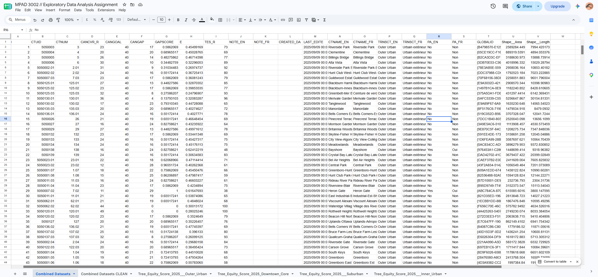
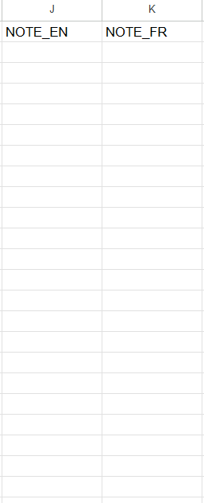
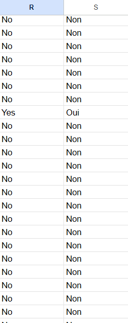
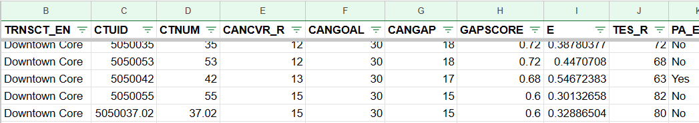
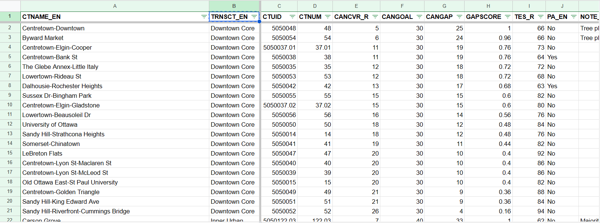
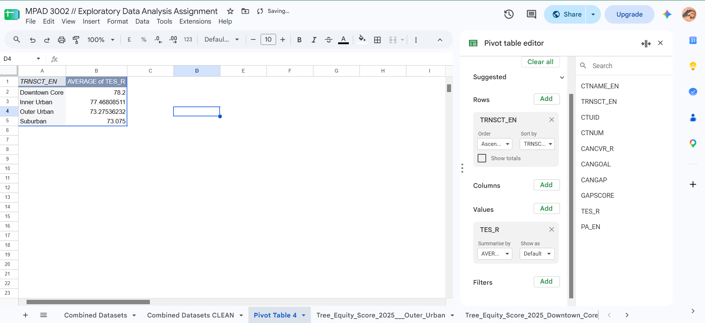
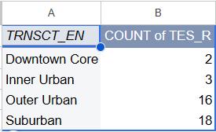
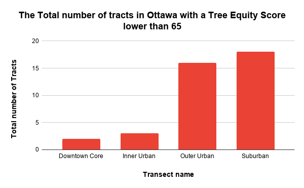

**2026-11-06** 
**MPAD 2003 - Introductory Data Storytelling** 
**Beracah Okere** 
**Presented to Jean-Sébastien Marier** 

# Deliverable 2: Exploratory Data Analysis (EDA)

<!---Use one hashtag symbol (`#`) to create a level 1 heading like this one.--->

## 1. Getting Data
I will be analyzing a group of datasets: the Tree Equity Score 2025 datasets for the Suburban, Downtown Core, Inner Urban & Outer Urban transects in Ottawa which discuss the Tree Equity Scores for the tracts within these transects as well as other additional information like the tree canopy coverage goal for the transect, how much an individual tract contributes to the goal, and which tracts are marked as priority areas.

To acquire my data, I went onto the Open Ottawa Data portal where I grabbed the [Tree Equity Score 2025 – Suburban](https://open.ottawa.ca/datasets/ottawa::tree-equity-score-2025-suburban/about), [Tree Equity Score 2025 - Inner Urban](https://open.ottawa.ca/datasets/ottawa::tree-equity-score-2025-inner-urban/about), [Tree Equity Score 2025 - Outer Urban](https://open.ottawa.ca/datasets/ottawa::tree-equity-score-2025-outer-urban/about) and [Tree Equity Score 2025 - Downtown Core](https://open.ottawa.ca/datasets/ottawa::tree-equity-score-2025-downtown-core/about) CSV files and imported them into a Google Sheets spreadsheet - with each dataset as separate sheets.

[Link to Google Sheets Spreadsheet](https://docs.google.com/spreadsheets/d/1d3Lvmx_JqoSBCxjXgUR8HhP2DmRbiaoiUP7RjvqKjkI/edit?usp=sharing)

*Figure 1: Example of me importing a dataset into Google Sheets*

The datasets I had imported were mostly clean, being very easy to understand all and I was unable to find any spelling mistakes, whitespaces or other issues that could cause concern. The sets also have a combined total of 217 rows and 22 columns. The only difference I noticed was that decimal values for the data I downloaded had a total of 6 decimal places compared to Open Ottawa data with 3 decimal places.

*Figure 2: a screenshot showcasing the uncleaned combined version of the datasets imported*

Moving unto the data itself, most of the data in these sets are numerical data. Column I ("TES_R") contains discrete ratio data containing the Tree Equity Scores for different tracts and those values are between 0 to 100 (Tree Equity Score, 2026), Column P (TRNSCT_EN)however in my combined set , contains nominal variable as the contain the names of the 4 transects in Ottawa and finally COLUMN G (GAPSCORE),contains continuous data as the decimal values for the score which include a theoretically infinite amount of values not greater than 1.
From this data a key questions arise: how do the different transects compare in terms of reaching their tree canopy goals? And, which tracts seem to be particularly lacking in terms of trees and their Tree Equity Scores? Which areas does the city designate as Priority Areas and what are the reasons as to why certain areas aren't marked as priority?

## 2. Understanding Data

### 2.1. VIMO Analysis
Moving onto my VIMO Analysis, due to the data I am utilising being mostly cleaned up and very readable outside of specific things I took issue with I didn't have much to say for my VIMO analysis. My analysis follows the information discussed in Statistics Canada video from Module 6.

**Valid/Invalid**
In terms of valid and invalid values, I would say that the data shown in this dataset are all valid data, none of the information present seems out of place with the columns where you would expect numerical data containing numerical data and the columns where you would expect text containing that as well. All of the information shown makes sense for the data they are collecting and what you would expect out of this kind of dataset. 

**Missing**
While, there is no invalid data in this dataset, there are 4 notable columns which have missing data. Namely columns J and K (NOTE_EN & NOTE_FR) and Columns R and S (PA_EN & PA_FR). It makes sense for columns J and K to contain rows that are empty, as these columns are for additional notes written in both French and English for select variables, however for Columns R and S it gets a bit problematic as there is no explanation for why some columns get Yes or No values and others don't regarding whether they are priority areas or not. It is only data part of the Suburban transect which have this issue, but the assumption to be made is that the empty columns are most likely not priority areas which I could dive into more in my analysis.

 

*Figure 3: Screenshots of the discussed columns above*

**Outlier**
Finally, for outlier values, there are no outlier values in this dataset, all the information presented are within reason and no variables seem impossible or absurdly high/low for the metric they are measuring.

### 2.2. Cleaning Data
Moving on I now had to clean my data and this step was fairly easy since these datasets were already mostly cleaned up and lacked any noteable errors as explained in my VIMO Analysis. During this step I largely focused on cleaning up this dataset to make it more focused on the specific analysis I wanted to conduct which was to compare the Tree Equity Scores in different transects to each other as well as see which transects required the most attention and also remove additional details that weren't important to me.

Starting off, I combined the data from the different datasets together. This was extremely easy as it just required me copying and pasting the values from different sheets into a single one. After doing that I then froze the top row of the my combined dataset and also made the text bold as shown in the screenshot below.

*Figure 4: Screenshot showcasing top row being frozen with bold text*

After doing that I then removed the columns that I didn't need, that being columns A, H, K, L, M, O,  Q, T, U and V. Some of these columns included text in french which I didn't need for my analysis, as well as other information not important for my EDA such as the ID numbers of certain places and location data.

After doing that I then shifted around the columns moving the *CTNAME_EN* and *TRNSCT_EN* column to the leftmost part of the dataset, and then froze those columns.

And finally I added filters to my column titles to make the information easier to filter and aid in the process of me analysing the data further on.

*Figure 5: Screenshot showing part of my cleaned up dataset with the frozen left rows*

### 2.3. Analyzing Data
To start off, I first created a pivot table and calculated the average Tree Equity Score for the different transects. All of the transects have decent scores, with all of them having a value above 70, indicating that although these transects should aim for more trees overrall they have a fair amount of tree canopy coverage. With the Downtown Core transect having the highest number and the Suburban Transect the lowest value.

*Figure 6: Screenshot of a pivot table with TRNSCT_EN as the rows and AVERAGE of TES_R as the values I am looking into*

After doing that I then created another pivot table, that showcased the count of tracts within these transects that have a TES lower than 65 (a score which indicates that these are areas that are of higher priority). 

*Figure 7: Screenshot of a pivot table, showcasing a count of the total number of TRNSCT_EN values that contain tracts with a TES_R (Tree Equity Score) less than 65*

After creating these pivot tables, I how had the data I needed to create exploratory chart which I can use to tell the story I hope to tell about Ottawa's progress regarding it's tree canopies. As detailed in their Master Plan document, the City of Ottawa amongst other sustainable/environmentally focused aims, hopes to ensure that 40% of urban areas are covered by tree canopy. While we have evidence of this progression as shown in the data provided. It is clear that there is still a lot of progress to be made with the total of 39 tracts/neighourhoods in the city that need more trees.

I found my story by following similar steps to *How to 'interview' a big pile of data* article that was discussed in our readings, cleaning up, grouping and creating pivot tables that helped me find an angle I could fixate on when creating my story.

I decided to create a bar chart of my pivot table calculating the total number of tracts in each transect with a TES lower than 65. To showcase the areas in the city that should be focused on when it comes to planting more trees, that being very notably the Outer Urban and Suburban areas of the city.

*Figure 8: Bar chart showcasing the total number of tracts per transect in the City of Ottawa that have a Tree Equity Score lower than 65*

I decided for my analysis to focus largely on the Tree Equity Score data and the transect names/ count of tracts as these are intergral parts ofthe story I hope to tell. Exploring this data, I can see a potential story regarding the areas that the city should focus on and how that compares to the actual areas designated as priority areas and the reasons as to why. I can also compare my data to preexisting news, noting which neighbourhoods/regions tend to get particular attention when addressing this issue compared to the data shown here that demonstrates the areas that more notably compared to others are lacking in tree canopy coverage. The variables that require further investigation are the Priority Area data, because as mentioned previously, for the Suburban transect most of the tracts are missing information on whether or not they are priority areas and with the discovery presented here, it requires further examination into why a region in Ottawa which compared to others in clearly in more need of trees lacks this data.

## 3. Delivering Data

To conclude, after conducting my analysis, I am able to look more clearly into the data I have gathered. Although at the start of my EDA I had a vague shape of a story I was unsure how on how I could explore, actually looking into the data and examining it has given me a good idea of the data story I hope to pursue.
I want to look more into the transects (the Outer Urban and Suburban regions) that are noticably lacking compared to other regions tree canopies and the reasons as to why. For my analysis I hope to interview a representative from Ecology Ottawa or City of Ottawa’s Forestry Services that can provide the key insight needed into the reasons for this issue. The resources I found could aid in providing insight into this issue was the *How is Ottawa's Urban Tree Canopy Doing?* blog post posted by Kristen Busby February this year. I also got insight from the Kitchissipi Times article *Ottawa’s urban neighbourhoods falling behind on tree canopy targets* written by Amanda McLeod and the *As Ottawa expands tree planting initiatives, the federal government makes cuts to its own* by Kaitlin Gruehl that gave insight into the actions the city is taking to tackle this issue and the other governmental issues that may be affecting their progress. 

## 4. References
“Methods & Data.” Tree Equity Score. Accessed November 1, 2026. https://www.treeequityscore.org/methodology.

The City of Ottawa. (2026) Tree Equity Overview - Tree Equity | City of Ottawa. Retrieved October 30, 2026, from https://ottawa.ca/en/living-ottawa/environment-conservation-and-climate/trees-and-urban-forests/tree-equity/tree-equity-overview

Eads, David. “How to ‘interview’ a Big Pile of Data.” NPR, October 15, 2016. https://www.npr.org/sections/npr-training/2025/05/29/g-s1-67278/how-to-interview-a-big-pile-of-data. 

Government of Canada, Statistics Canada. “Data Accuracy and Validation: Methods to Ensure the Quality of Data.” Government of Canada, Statistics Canada, November 2, 2026. https://www.statcan.gc.ca/en/wtc/data-literacy/catalogue/892000062020008. 

Kristen Busby. (2026) How is Ottawa's Urban Tree Canopy Doing? - Ecology Ottawa. Retrieved October 30, 2026, from https://www.ecologyottawa.ca/tree-canopy-mapping

Amanda McLeod. (2026) Ottawa’s urban neighbourhoods falling behind on tree canopy targets. Retrieved October 30, 2026, from https://kitchissippi.com/ottawas-urban-neighbourhoods-falling-behind-on-tree-canopy-targets/

Amanda McLeod. (2026) Ottawa’s urban neighbourhoods falling behind on tree canopy targets. Retrieved October 06, 2026, from https://kitchissippi.com/ottawas-urban-neighbourhoods-falling-behind-on-tree-canopy-targets/

Government of Canada, Statistics Canada. “Data Accuracy and Validation: Methods to Ensure the Quality of Data.” Government of Canada, Statistics Canada, November 1, 2026. https://www.statcan.gc.ca/en/wtc/data-literacy/catalogue/892000062020008. 